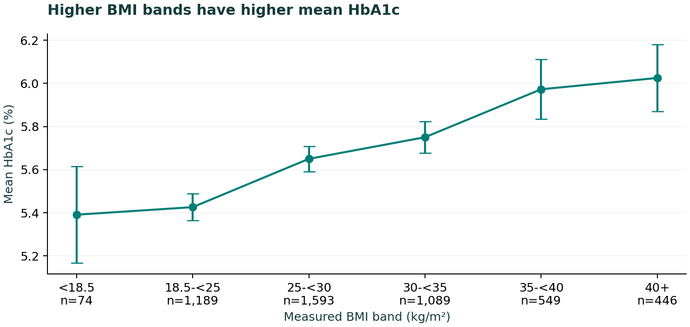
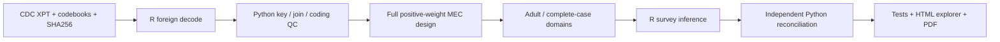

# NHANES Adult Health Analytics & Reporting

**An auditable public-health analysis, from four source tables to survey-aware estimates.**
Independent portfolio project by Xiangyi (Sam) Kong, completed October 2026.
Not affiliated with Kaiser Permanente and not clinical research conducted there.

Among **4,940 adult complete cases** in NHANES 2017-2018, each 5 kg/m² higher
BMI was associated with **0.125 percentage points higher HbA1c** after adjustment
for age and recorded sex (**95% CI 0.103–0.146**). Cross-sectional association
cannot establish a causal effect or provide an individual diagnosis.

[Two-page research brief](reports/brief.pdf) · [Interactive report source](reports/report.html)
· [Model results](evidence/model_results.csv) · [Analysis plan](docs/analysis_plan.md)
· [Data dictionary](docs/data_dictionary.csv) · [中文说明](docs/README_CN.md)





## Reproduce

Python **3.12**, R **4.6.1**, R `survey` **4.5** were used. Exact Python dependency
snapshot and R package versions are committed. No paid service or API key needed.
The complete environment snapshot also includes the companion Airbnb geospatial
libraries; `requirements.txt` lists this analysis's direct Python dependencies.

```bash
python3 -m venv .venv
source .venv/bin/activate
pip install -r requirements.lock.txt
Rscript setup.R
export R_LIBS_USER="$PWD/.Rlibrary"
bash run_all.sh
python -m http.server 8000
# Open http://localhost:8000/reports/report.html
```

`PYTHON=/path/to/python bash run_all.sh` supports an existing environment. Missing
sources download from CDC; cached and downloaded bytes must match the reviewed
SHA256 lock. A revised source requires explicit investigation, not an automatic
refresh. Failures remove old public report files; report generation only follows
QC, R estimation, independent reconciliation and tests. `evidence/run_log.json`
records runtime, environment, plan/source hashes and stage timings. Clean-directory
reproduction is recorded in `evidence/clean_run.json`.

## Cohort and sampling design

| Sequential stage | Observed n | Excluded at stage |
|---|---:|---:|
| DEMO participants | 9,254 | — |
| Age 20+ | 5,569 | 3,685 |
| Positive MEC weight | 5,265 | 304 |
| BMI available | 5,175 | 90 |
| HbA1c and adjustment fields available | 4,940 | 235 |

No duplicate removal, imputation or deletion based on significance. All four keys
are unique/nonmissing; left joins preserve the 9,254 DEMO rows. The complete-case
cohort excludes 325 positive-weight adults; [demographic comparison](evidence/complete_case_comparison.csv)
shows retained/excluded selection. DIQ010 borderline/refused/unknown categories
are kept distinct; HbA1c values 7 or 9 are valid measurements.

The `survey::svydesign` object is built on **8,704 positive-weight MEC participants**
before adult/complete-case subsetting, using `WTMEC2YR`, `SDMVSTRA`, nested
`SDMVPSU`. There are 15 strata and 30 PSUs (design df 15). Means use 95% t intervals
with domain design df. Primary `svyglm` regression uses residual design df 12;
race-adjusted regression uses df 7. Singleton PSUs fail rather than being hidden.
The primary outcome is continuous HbA1c (%), BMI is scaled per 5 kg/m².

## Sensitivity and diagnostic evidence

| Specification | BMI coefficient (HbA1c pp / 5 kg/m²) | 95% CI | n |
|---|---:|---|---:|
| Primary: age + sex | 0.1245 | 0.1031–0.1460 | 4,940 |
| DIQ010=2 only | 0.0754 | 0.0607–0.0901 | 3,994 |
| Additional race/ethnicity adjustment | 0.1247 | 0.1000–0.1495 | 4,940 |

The “no reported diabetes” domain is not proof of absence of diabetes. The
prespecified quadratic BMI check is in `model_results.csv`; its linear term is
not a constant per-5-unit effect. Aggregate residual diagnostics and leverage
summaries are in [model diagnostics](reports/model_diagnostics.html).
Weighted versus unweighted means appear together in `table1.csv` and the explorer.

Python independently reproduces both weighted means, their stratum/PSU Taylor
standard errors, and all four primary regression coefficients: **8/8 checks pass**.
Unit/integration tests cover corrupt keys, absent schema, invalid questionnaire
codes, zero weights, flow conservation, and out-of-domain PSU scores.

### Actual issue investigated

Pandas 2.3.3 `read_sas(...,format='xport')` represented 550 source zero MEC weights
as approximately 5.4e-79. Treating these as positive would incorrectly include
interview-only participants in the design. R `foreign::read.xport` correctly
preserves zero; it is the production decoder. A [decoder audit](evidence/decoder_audit.csv)
and fixed-data regression test guard this error. No blanket small-value recoding
is applied to measurements. BMI/height/weight checks found no discrepancies >0.2
kg/m² across 8,005 available pairs. Real extremes remain included.

## Deliverables and data use

- `src/`: download verification, decoding, ETL/QC, survey inference, independent
  reconciliation, report generation and the static dashboard template.
- `evidence/`: aggregate audits, numerical tables, tests and run evidence.
- `reports/`: responsive HTML explorer, two-page PDF, three figures, diagnostics.
- `docs/`: frozen plan, dictionary, source lock, coding rules, limitations,
  verified resume statements and interview notes.
- `data/raw`, `data/processed`: local-only XPT/codebooks/participant-level
  derivatives. Excluded from Git. No participant screenshot or row data is published.

Official source components: [DEMO_J](https://wwwn.cdc.gov/Nchs/Data/Nhanes/Public/2017/DataFiles/DEMO_J.htm),
[GHB_J](https://wwwn.cdc.gov/Nchs/Data/Nhanes/Public/2017/DataFiles/GHB_J.htm),
[BMX_J](https://wwwn.cdc.gov/Nchs/Data/Nhanes/Public/2017/DataFiles/BMX_J.htm),
[DIQ_J](https://wwwn.cdc.gov/Nchs/Data/Nhanes/Public/2017/DataFiles/DIQ_J.htm).
Method: [CDC variance and domain analysis tutorial](https://wwwn.cdc.gov/nchs/nhanes/tutorials/varianceestimation.aspx).
Use is limited to statistical analysis and reporting under the
[NCHS data-use agreement](https://www.cdc.gov/nchs/data_access/restrictions.htm);
no identification or linkage to identifiable personal information. Code is MIT;
that license does not replace the data-use agreement.

## Limitations

Historic single-cycle estimates; complete-case bias, treatment and unmeasured
confounding; top-coded age (80); linear age adjustment; sparse BMI domains;
pregnancy not excluded in this minimal fixed scope. This is not a current
prevalence estimate, causal analysis, disease-prediction tool or clinical advice.
See [full limitations](docs/limitations.md).

## Machine learning supplement

Added PSU-grouped five-fold held-out HbA1c benchmarks on 4,940 adults. Weighted MAE: mean baseline 0.5460, age/sex ridge 0.4987, age/sex/BMI ridge 0.4867, gradient boosting 0.5003 percentage points. BMI ridge reduced MAE by 10.9% versus the mean baseline. The nonlinear model did not outperform ridge. These are concurrent measurements, not future diabetes prediction.

Open [ML report](reports/ml_report.html), [one-page brief](reports/ml_brief.pdf), [frozen protocol](docs/ml_plan.md), [model card](docs/ml_model_card.md), and [aggregate evidence](evidence/ml_results.json). The existing `bash run_all.sh` now reproduces the ML module too. No additional credentials or service are required. Individual predictions stay under ignored `data/processed/`.
